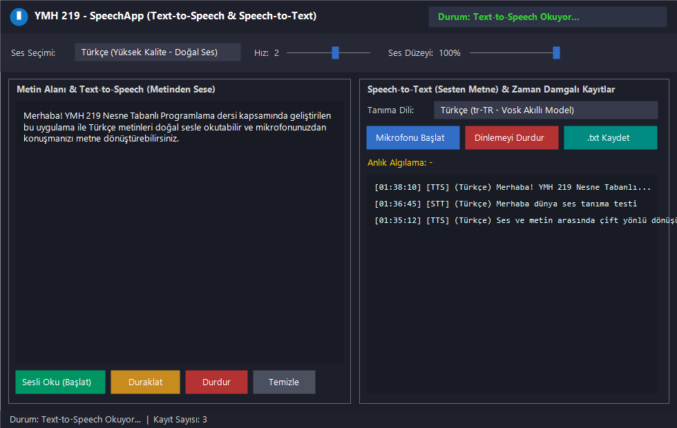
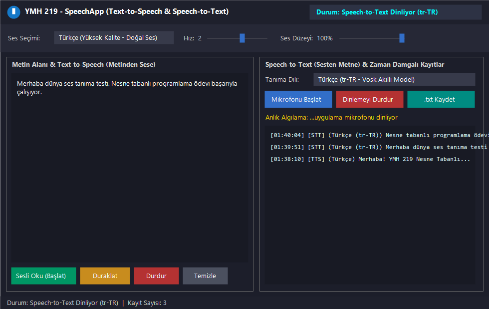

# YMH 219 - Speech-to-Text ve Text-to-Speech Uygulaması (SpeechApp)

**Ders:** YMH 219 - Nesne Tabanlı Programlama (C# .NET 8.0 WinForms)  
**Geliştirici:** [agumusfu](https://github.com/agumusfu)

---

## Proje Hakkında

Bu proje, ses ve metin arasında çift yönlü dönüşüm yapabilen bir Windows Forms masaüstü uygulamasıdır. Kullanıcı metin alanına yazdığı metni sesli olarak okutabilir (**Text-to-Speech**) veya mikrofondan aldığı konuşmayı gerçek zamanlı olarak metne dönüştürebilir (**Speech-to-Text**).

---

## Ekran Görüntüleri

### Text-to-Speech (Metinden Sese Okuma)


### Speech-to-Text (Mikrofon Dinleme ve Zaman Damgalı Kayıtlar)


---

## Kullanılan Teknolojiler ve Paketler

- **Platform:** C# / .NET 8.0 (`net8.0-windows`) Windows Forms
- **NuGet Paketleri:**
  - `System.Speech` (`8.0.0`) — Yerel Windows SAPI5 ses sentezi ve konuşma tanıma
  - `Vosk` (`0.3.38`) — Çevrimdışı yüksek doğruluklu **Türkçe (`tr-TR`)** ve İngilizce (`en-US`) konuşma tanıma
  - `NAudio` (`2.2.1`) — Mikrofon ses yakalama (`WaveInEvent`) ve akıcı ses oynatma (`WaveOutEvent` / `Mp3FileReader`)
- **Dosya İşlemleri:** `System.IO.StreamWriter` (UTF-8 `.txt` dışa aktarımı)

---

## Proje Yapısı

```text
YMH219-SpeechApp/
├── .gitignore
├── README.md
├── docs/
│   └── screenshots/
│       ├── tts_speaking.png
│       └── stt_listening.png
└── SpeechApp/
    ├── SpeechApp.csproj
    ├── Program.cs
    ├── MainForm.cs
    ├── MainForm.Designer.cs
    ├── Models/
    │   └── SpeechRecord.cs              # Zaman damgalı TTS/STT kayıt modeli
    └── Services/
        ├── TextToSpeechService.cs       # SpeechSynthesizer sarmalayıcı (IDisposable)
        ├── SpeechToTextService.cs       # SpeechRecognitionEngine sarmalayıcı & hata yönetimi
        └── TranscriptExportService.cs   # StreamWriter ile .txt dışa aktarım servisi
```

---

## Temel Özellikler

- **Text-to-Speech (TTS):**
  - Metin alanındaki (`RichTextBox`) Türkçe veya İngilizce içeriği doğal sesle okuma
  - **Başlat**, **Duraklat / Devam Et**, **Durdur** ve **Temizle** kontrolleri
  - Yüksek kaliteli Türkçe/İngilizce doğal ses ile yerel `[Yerel SAPI]` sistem sesleri arasında seçim (`ComboBox`)
  - Okuma hızı (`-10` ile `+10`) ve ses düzeyi (`0%` ile `100%`) ayarı
- **Speech-to-Text (STT):**
  - Vosk + NAudio tabanlı **Türkçe (`tr-TR`)** ve İngilizce (`en-US`) çevrimdışı konuşma tanıma
  - Mikrofon üzerinden konuşmayı algılayıp anlık tahmin (`Anlık Algılama`) ve kesinleşen metni metin alanına aktarma
  - Mikrofon veya konuşma tanıma servisine erişilemediğinde kullanıcıya anlaşılır Türkçe hata mesajları
- **Arayüz ve Dışa Aktarım:**
  - Özel mikrofon/ses dalgası uygulama ikonu (`app.ico`) ve koyu tema arayüz
  - Üst rozet ve alt durum çubuğu (`StatusStrip`) üzerinden aktif işlemin anlık gösterimi
  - Her TTS/STT işleminin zaman damgasıyla listelenmesi ve `.txt` dosyasına kaydedilmesi

---

## Kurulum ve Çalıştırma

### Gereksinimler
- Windows 10/11
- [.NET 8.0 SDK](https://dotnet.microsoft.com/download/dotnet/8.0)

### Derleme ve Çalıştırma

```powershell
dotnet build SpeechApp/SpeechApp.csproj
dotnet run --project SpeechApp/SpeechApp.csproj
```

---

## Bilinen Sınırlamalar ve Geliştirme Notları

- **Türkçe Speech-to-Text (Vosk):** İlk kez Türkçe veya İngilizce akıllı model seçilip mikrofon başlatıldığında ~35–40 MB boyutundaki Vosk modeli `%LocalAppData%\SpeechApp\models\` dizinine otomatik olarak indirilir; sonraki kullanımlarda tamamen çevrimdışı çalışır.
- **Türkçe Text-to-Speech:** Varsayılan yüksek kaliteli doğal Türkçe/İngilizce seslendirme için internet bağlantısı gerekir; çevrimdışı durumlarda `[Yerel SAPI]` sistem sesleri kullanılabilir.
- Mikrofon bulunmadığında veya servis erişim hatasında `SpeechToTextService` durumu yakalayarak kullanıcıya anlaşılır hata mesajı gösterir.
